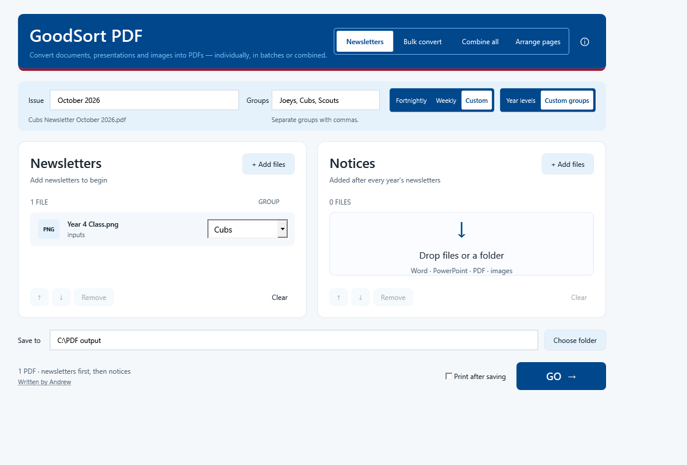
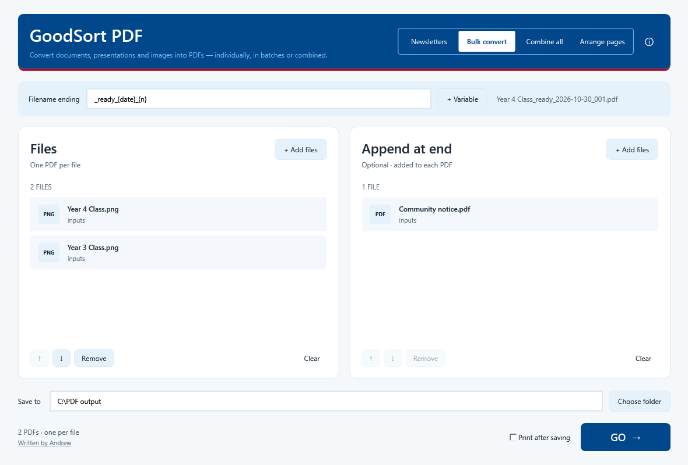
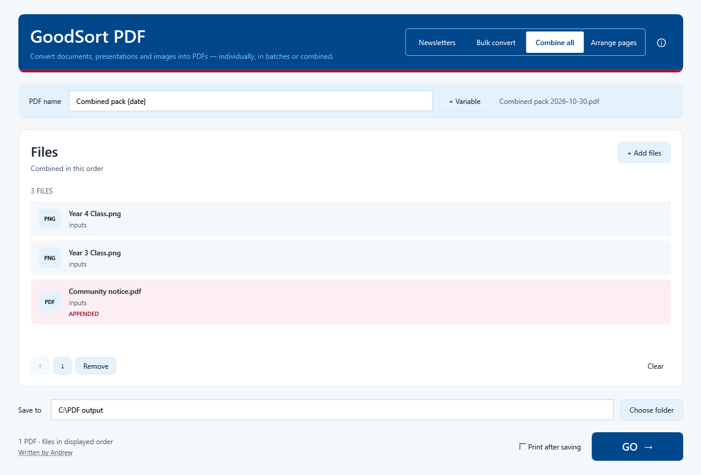
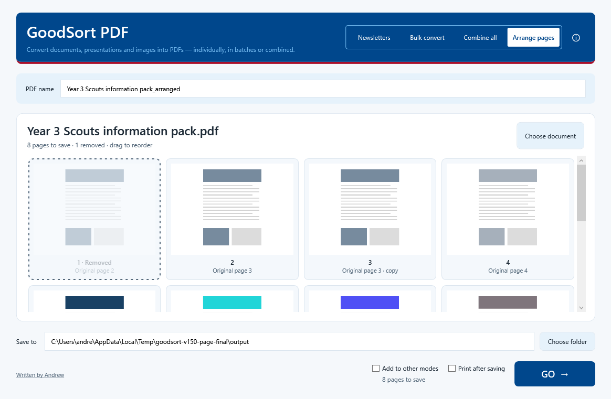

# GoodSort PDF user guide

[Back to the project overview](../README.md) · [Download the latest release](https://github.com/CoderBananna/GoodSort-PDF/releases/latest)

## Find what you need

- [Download and open](#download-and-open) · [Requirements](#requirements) · [Choose a mode](#choose-a-mode)
- [Newsletters](#prepare-newsletters) · [Weeks without notices](#weeks-without-notices) · [Custom groups](#custom-groups-for-clubs-and-community-organisations)
- [Bulk convert](#bulk-convert-to-pdf) · [Combine all](#combine-all-files-into-one-pdf) · [Filename variables](#filename-variables)
- [Arrange pages](#arrange-individual-pages) · [Save and print](#save-and-print-in-one-batch)
- [Supported formats](#supported-formats) · [Layout and links](#layout-colours-and-hyperlinks) · [Compression](#pdf-compression)
- [Files and privacy](#files-and-privacy) · [Troubleshooting and limits](#troubleshooting-and-limits)

## Download and open

Download **GoodSort.PDF.1.5.0.exe** from the [latest release](https://github.com/CoderBananna/GoodSort-PDF/releases/latest). Save it wherever you prefer, such as your desktop, and double-click it to run.

The app is supplied as a **single executable**. It does not need an installer, Adobe Acrobat, Python or a separate .NET installation. The executable includes its runtime and is approximately 72 MB; this is separate from the size of the PDFs it creates. The current build is unsigned.

## Requirements

- **64-bit Windows 10 version 2004 or later, or Windows 11 (x64).**
- **Desktop Microsoft Word** to convert Word documents and RTF files.
- **Desktop Microsoft PowerPoint** to convert presentations.
- The fonts used in Office documents should be installed for faithful formatting.

Office is not required when working only with existing PDFs and images. The app is built for Windows; it does not run natively on macOS or Linux.

## Choose a mode

Use the rectangular four-position switch beside the About button:

| Mode | Output | Naming |
| --- | --- | --- |
| **Newsletters** | One PDF per year level or custom group, with optional shared notices afterwards. | Fortnightly, Weekly or a Custom issue label. |
| **Bulk convert** | One PDF per input file; optional documents are appended to every output. | Original filename plus an optional text or variable ending. |
| **Combine all** | One PDF containing the files in the single expanded list, in the order you choose. | A filename you choose, with optional variables. |
| **Arrange pages** | One new PDF with individual pages reordered, duplicated or removed. | A filename you choose; the original is unchanged. |

Switching modes keeps your files, their order and any year-level assignments. Term/week selectors and year fields appear only in Newsletters mode. The app remembers your selected mode, newsletter frequency, custom group list, issue label and naming preferences for next time.

## Prepare newsletters

1. Open **GoodSort PDF** and select **Newsletters** mode.
2. Drag newsletter files or a folder into **Newsletters** on the left. The app suggests year levels from filenames and folders; check or change the year beside each item.
3. If you have shared notices, drag them into **Notices** on the right; otherwise leave that column empty. Use the arrows to arrange files in the order you want them to appear.
4. Choose **Fortnightly**, **Weekly** or **Custom** in the blue naming bar. Select the term and week(s), or enter a custom issue label.
5. Select an output folder and click **GO**.
6. Use **Open folder** to find the completed PDFs.

If several newsletters belong to the same year level, they are combined in their displayed order. Every notice is then appended to every year's PDF. Notices are optional. Folder drops include subfolders, and unsupported file types are reported.

### Example

| Newsletters on the left | Notices on the right |
| --- | --- |
| Year 3 class newsletter.docx | Sports notice.pdf |
| Year 4 class newsletter.pptx | Community event.png |

For Term 2, Weeks 5–6, this produces:

- `Year 3 Newsletter Term 2 W5-6.pdf` — Year 3 newsletter, sports notice, community event.
- `Year 4 Newsletter Term 2 W5-6.pdf` — Year 4 newsletter, sports notice, community event.

Prep uses `Prep Newsletter Term 2 W5-6.pdf`, without a “Year” prefix. Combined year levels can use a label such as `5-6`.

### Weekly, fortnightly or custom issues

The selectors on the right of the blue bar sit on the same line as the naming fields and offer:

| Choice | Naming controls | Example output |
| --- | --- | --- |
| **Fortnightly** (default) | Term, first week and last week. | `Year 3 Newsletter Term 2 W5-6.pdf` |
| **Weekly** | Term and one week. | `Year 3 Newsletter Term 2 W5.pdf` |
| **Custom** | An issue label you type; term/week fields are hidden. | `Year 3 Newsletter Camp update.pdf` |

Custom labels are literal text, such as `October 2026` or `Camp update`. An empty Issue field shows example placeholder text: “e.g. October, Camp Update”. The preview shows the resulting filename. Invalid filename characters are reported before processing.

### Custom groups for clubs and community organisations

**Year levels** remains the default, including Prep and Years 1–12. Select **Custom groups** to use names such as **Joeys, Cubs, Scouts** instead. Enter your own comma-separated list in **Groups**—the hint beneath the field explains the separator—then check or edit the group beside each file. Custom group names do not receive a “Year” prefix.

For example, select **Custom**, enter `October 2026`, and assign a newsletter to **Cubs** to produce `Cubs Newsletter October 2026.pdf`. Multiple files assigned to Cubs are combined in their displayed order, followed by any shared notices. Every other group receives its own PDF.

The app suggests groups from filenames and folders. Check each assignment and change it if needed; your manual choices are retained when you switch modes or grouping options.

## Weeks without notices

**You can use GoodSort PDF even when there are no notices to add.** This makes it useful every fortnight, including when teaching teams submit newsletters in different formats and you simply need consistently named PDFs ready to distribute.

Select **Newsletters** mode, add the newsletters to the left column, leave **Notices** empty, check the year levels, select the term and weeks, and click **GO**. The app will still:

- **Convert** supported Word, PowerPoint and image files to PDF. Existing PDFs are accepted too.
- **Compress** each output automatically, aiming for roughly 10 MB or less. This is a flexible target; the app reports files that remain larger.
- **Name** each output using the selected year level, term and weeks.
- **Prepare one PDF per year level**, containing only that year's newsletter material. Multiple files assigned to the same year are combined in their displayed order.

For example, a Year 3 Word newsletter can become `Year 3 Newsletter Term 2 W5-6.pdf` with nothing in the Notices column. You can process one year level or several in the same run. Your original files remain unchanged; the named PDFs are saved in your chosen output folder.

Desktop Word or PowerPoint is still required for its respective file types. No extra setting or different workflow is needed for weeks without notices.

## Bulk convert to PDF

Select **Bulk convert**, add your documents to **Files** on the left and choose an output folder. Each input file becomes a separate PDF, including files whose names contain no year level. Word, PowerPoint, PDF and supported image files can be mixed in the same batch.

The **Append at end** column is optional. Add one or more documents there to include them after each converted file—for example, a standard information sheet or a booking form. Leave it empty for conversion only.

Leave **Filename ending** empty to retain each input's base name, or enter text and variables to add before `.pdf`. The preview shows an example. Spaces and separators in the ending are used as typed.

For example, using the ending `_ready_{date}_{n}` on 30 October 2026:

| Input, in displayed order | Output |
| --- | --- |
| `Meeting notes.docx` | `Meeting notes_ready_2026-10-30_001.pdf` |
| `Presentation.pptx` | `Presentation_ready_2026-10-30_002.pdf` |

If different input files would produce the same filename, the app adds a number such as ` (2)` to distinguish them. Existing files in the output folder are still never overwritten.

## Combine all files into one PDF

Select **Combine all** to use a single **Files** list. Add all your documents to this one list. Select a file and use **↑** or **↓** to set the order before clicking **GO**. The app converts the files as needed and combines their pages into one PDF in that exact order.

Enter the output filename in **PDF name**; `.pdf` is added automatically. You can use the same filename variables as Bulk convert. There is no separate append panel in this mode. Put any closing pages at the bottom of the same list.

For example, a Word cover letter, PowerPoint presentation and PDF handout can become a single `Information pack.pdf`. Notices or appended files already loaded appear at the bottom of this list with a pale burgundy background and an **APPENDED** label. They are included once, and you can reorder them like any other file. Switching back to Newsletters or Bulk convert returns appended items to the right-hand column. Removing an appended item in Combine all removes it from the selection; it will not reappear when switching back.

## Filename variables

Click **+ Variable** to insert a variable, or type it into the filename field.

| Variable | Meaning | Example |
| --- | --- | --- |
| `{date}` | The computer's local date when GO is clicked. | `2026-10-30` |
| `{time}` | The local time, using a filename-safe 24-hour format. | `14-05` |
| `{n}` | Input position in Bulk convert, starting at 001. | `001`, `002`, `003` |

All files in one run share the same date and time. In Combine all, `{n}` is always `001` because there is one output. Variables affect the naming field you enter; existing text in an input filename is left as-is. Invalid filename characters or unknown variables are reported before conversion starts.

## Arrange individual pages

Drop one PDF, Word document, PowerPoint presentation or supported image into **Arrange pages**. Non-PDF files are converted first, using the same offline conversion as the other modes. Thumbnails appear as pages come into view.

1. **Drag a page** to change its position. The insertion line shows where it will go; dragging near the top or bottom scrolls the list.
2. **Right-click → Duplicate page** to add a copy after that page.
3. **Right-click → Remove page** to exclude a page. It stays visible, washed out with a dotted border, so you can still see what was removed.
4. **Right-click → Undelete page** to restore it in its current position.
5. Choose a **PDF name** and **Save to** folder, then click **GO**. Only the kept pages are saved, in their displayed order. At least one page must remain.

The checkbox **Add to other modes**, beside GO, updates the other modes after saving. If you opened a file already in a list, the edited PDF **replaces that list item in the same position**, retaining its year/custom group. An appended item opened from Combine all keeps its appended role and returns to the notices column. Your original file on disk stays unchanged. If the document has no source list item, the PDF is added to the shared left-hand Files/Newsletters list. Further checked saves update the same entry rather than adding duplicates. Leave the checkbox unchecked to save only, leaving the lists unchanged.

You can also **right-click any PDF in the left column of Newsletters, Bulk convert or Combine all and choose Arrange pages**. Switching modes retains your current arrangement. Replacing an unsaved arrangement or closing the app prompts before discarding it. Saved PDFs cannot be overwritten accidentally; choose a fresh name for another revision.

Keyboard alternatives: focus a page and press **Delete** to toggle removal, or **Ctrl+Left / Ctrl+Right** to move it one position.

Saved PDFs retain their text, vector content and supported web/email links. Internal links follow the retained pages; links to removed pages are omitted. A duplicated destination uses its first retained copy, while a page’s link to itself stays with that copy.

## Save and print in one batch

Tick **Print after saving** beside **GO** in any mode. When you click GO, choose your printer and settings once for the whole batch. GoodSort PDF saves the finished PDFs, then sends each one to that printer in order.

- **Newsletters:** print each group's finished newsletter, including any shared notices.
- **Bulk convert:** convert Word documents, presentations or images and print each resulting PDF. Already have PDFs? Drop in a folder to compress, save and print them instead.
- **Combine all:** print the single combined document in your chosen order.
- **Arrange pages:** print the saved arrangement, including duplicates and excluding removed pages. **Add to other modes** still works alongside printing.

Printing starts unchecked when you open the app. Leave it unchecked to save only. The printer's paper size, colour, copies and duplex settings apply to the batch; pages fit within its printable area without cropping. No separate PDF reader is required.

Large batches are sent gradually while the app stays responsive. If printing stops or fails, your saved PDFs remain available. **Cancel** stops further submissions; jobs already sent may still print, so use the Windows print queue to stop those. “Sent to printer” means Windows accepted the jobs, rather than confirming that paper has finished printing.

## Supported formats

| Input | File extensions | Conversion |
| --- | --- | --- |
| PDF | `.pdf` | Pages are merged directly. |
| Word / rich text | `.docx`, `.doc`, `.rtf` | Exported using desktop Word. |
| PowerPoint | `.pptx`, `.ppt` | Exported using desktop PowerPoint. |
| Images | `.jpg`, `.jpeg`, `.png`, `.bmp` | Fitted proportionately onto A4 pages. |

## Layout, colours and hyperlinks

Existing PDF pages keep their page dimensions, text, vector content, colour resources and hyperlink annotations. Internal page links are remapped when pages are combined. Word and PowerPoint use their own PDF export to preserve document formatting and supported links.

Images are fitted to **A4 portrait or landscape**, following the image's orientation. Their proportions are maintained and **no detail is cropped out**; unused space may remain around an image. Camera orientation and transparency are handled automatically.

A screenshot or photograph cannot supply clickable links that are not present in its image format. The app does not add OCR or recreate those links.

## PDF compression

The app automatically aims for **about 10 MB or less per output PDF**. It first applies lossless compression. If a PDF remains too large, supported images are progressively resized and recompressed while text, page layout and link annotations are retained.

The target is flexible: a very long or complex newsletter may still exceed 10 MB. The app reports those files after saving. It does not remove pages or notices to meet the target.

## Files and privacy

All document processing happens on the Windows computer. The app has no document-upload service.

- Sources are copied to a temporary working folder so the original files remain unchanged.
- Temporary working files are removed after processing when possible.
- All output PDFs are prepared before the batch is published.
- Existing output PDFs are never overwritten. Choose another destination folder or move the earlier PDFs before generating the same fortnight again.
- The app remembers your mode and naming preferences. Printing always starts unchecked when the app opens.

See the [privacy policy](PRIVACY.md) for stored preferences, network printers and folders, temporary files, and instructions for removing the app.

## Troubleshooting and limits

| What happens | What to check |
| --- | --- |
| PowerPoint reports “Could not convert argument 7 for call to ExportAsFixedFormat” | This affects the 1.5.0 download. The fix is in source/desktop version 1.5.1; a replacement public executable has not yet been published. |
| A year level is missing or incorrect | Edit the year beside that newsletter before clicking GO. |
| Word or PowerPoint cannot export | Check the required desktop application is installed and that the document opens without a password, repair or other prompt. |
| Office conversion times out | Each file has a three-minute limit. Dismiss any Office dialogs and retry. |
| An output filename already exists | Select a different output folder or move the earlier file. |
| Printing stops or fails | Your saved PDFs remain available. Check the Windows print queue before retrying, because jobs already sent may still print. |
| A printer asks for a new filename for every document | Choose a paper printer instead of a virtual PDF printer; GoodSort PDF already saves the PDF outputs. |
| An output is still over 10 MB | Reduce the number of notices or simplify unusually large source documents if a smaller file is essential. |

Protected, malformed and unsupported inputs produce an error rather than being silently omitted. PDF signatures, portfolios, interactive forms, document-level accessibility structures and interactive PowerPoint features are outside this version's supported scope. Print-device colour matching is not guaranteed.
